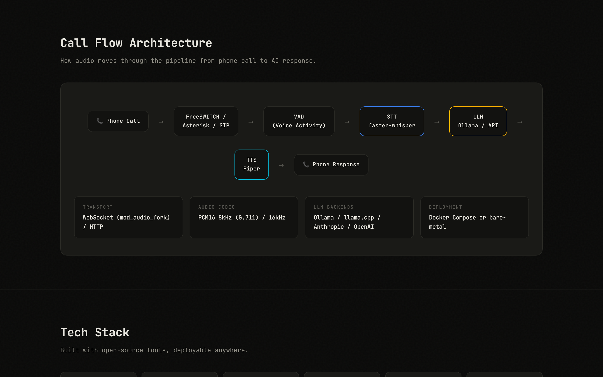
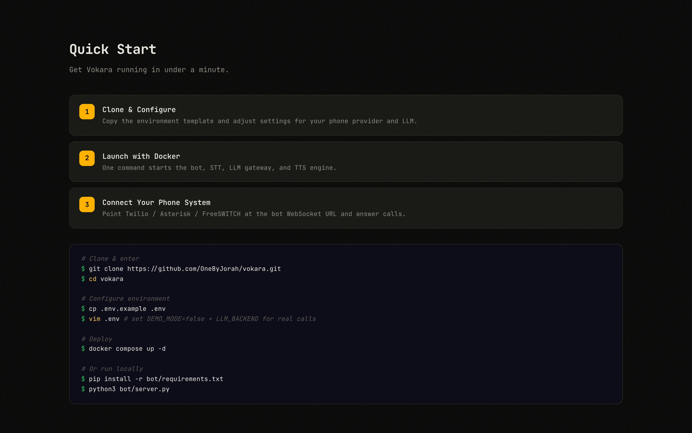

<div align="center">


# vokara

Self-hosted phone AI assistant — a real-time STT → LLM → TTS bot that bridges calls from FreeSWITCH, Asterisk, FreePBX, or 3CX.

Formerly VoiceCortex.

[](https://github.com/OneByJorah/vokara/actions/workflows/ci.yml)
[](https://github.com/OneByJorah/vokara/pkgs/container/vokara)
[](https://www.python.org/downloads/)
[](LICENSE)

</div>


## Why this exists

Cloud phone assistants send your call audio to someone else's servers. vokara keeps the whole loop on your own hardware: a PBX hands call media to a bot over WebSocket, the bot transcribes speech with faster-whisper, generates a reply with a local or hosted LLM, and speaks it back through Piper. The same bot logic works whether the call lands on FreeSWITCH, Asterisk, FreePBX, or 3CX.

Built for IT admins, MSPs, and telephony operators who want a phone assistant without sending call audio to a cloud.

## How it works

```text
Caller ──SIP/RTP──▶ PBX ──media──▶ FreeSWITCH / Asterisk
                                        │ WebSocket audio
                                        ▼
                              vokara bot (Python)
                              ├─ VAD (amplitude, or Silero if installed)
                              ├─ STT: faster-whisper
                              ├─ LLM: Ollama · llama.cpp · Anthropic/OpenAI
                              └─ TTS: Piper
                                        │ WebSocket audio
                                        ▼
                              Caller hears the reply
```

The bot also serves a small HTTP surface: an overview page and a `/healthz` probe.



## Quick start

Requires Docker and Docker Compose. Works on a machine with no GPU, no models, and no API keys — `.env.example` ships with `DEMO_MODE=true`, which serves the HTTP surface and runs the call loop with canned data.

```bash
git clone https://github.com/OneByJorah/vokara.git
cd vokara
cp .env.example .env
docker compose up -d --build
```

Then:

- Open the overview page: <http://127.0.0.1:8766>
- Health check: `curl http://127.0.0.1:8766/healthz` → `{"status": "ok", ...}`
- Call audio WebSocket listens on `127.0.0.1:8765` (for your PBX or a test client)

Stop with `docker compose down -v`.



### Real calls (DEMO_MODE=false)

Demo mode is for kicking the tires. For a live assistant:

1. Set `DEMO_MODE=false` in `.env`.
2. Choose an LLM backend and set its variables (`LLM_BACKEND=ollama|llamacpp|api`; only the variables for your backend matter).
3. Optionally download a Piper voice into `./piper-voices/` (mounted into the container at `/piper-voices`) and point `PIPER_VOICE` at it.
4. `docker compose up -d --build` again. First utterance loads the Whisper model — expect a pause the first time; it's cached after that.
5. Point your PBX at the bot. See below per PBX.

### Optional: bundled FreeSWITCH

If you don't already have a PBX, compose can start a FreeSWITCH profile:

```bash
docker compose --profile freeswitch up -d
```

Then dial extension 8500 from a SIP phone registered to that FreeSWITCH.

### Connect an existing PBX

- **FreeSWITCH** — use `mod_audio_fork` to stream call audio to `ws://<host>:8765` as raw PCM16 (8 kHz mono by default; set `SAMPLE_RATE=16000` for wideband).
- **Asterisk / FreePBX** — run `bot/server_asterisk.py` instead of `bot/server.py`. It uses ARI + `externalMedia` to receive RTP; setup notes are in that file's header.
- **3CX** — trunk a DID or extension into the bundled FreeSWITCH (same pattern as FreePBX).

## Configuration

All configuration is via environment variables (`.env`, loaded by compose). `.env.example` documents every variable.

| Variable | Default | Description |
| --- | --- | --- |
| `DEMO_MODE` | `true` | Canned call data; no models or keys needed. Set `false` for real STT/LLM/TTS. |
| `LLM_BACKEND` | `ollama` | `ollama`, `llamacpp`, or `api`. Ignored in demo mode. |
| `OLLAMA_HOST` | `http://127.0.0.1:11434` | Ollama server URL. |
| `OLLAMA_MODEL` | `llama3.1:8b-instruct-q4_K_M` | Ollama model name. |
| `LLAMACPP_HOST` | `http://127.0.0.1:8080` | llama.cpp OpenAI-compatible endpoint. |
| `API_PROVIDER` | `anthropic` | `anthropic` or `openai` (any OpenAI-compatible URL works via `API_BASE_URL`). |
| `API_BASE_URL` | `https://api.anthropic.com/v1/messages` | Hosted LLM endpoint. |
| `API_MODEL` | `claude-sonnet-4-6` | Hosted LLM model name. |
| `API_KEY` | — | Hosted LLM API key (server-side only). |
| `WHISPER_MODEL` | `small.en` | faster-whisper model size. |
| `WHISPER_DEVICE` | `cpu` | `cuda` or `cpu`. |
| `PIPER_VOICE` | `/piper-voices/en_US-amy-medium.onnx` | Piper voice file path inside the container. |
| `BOT_WS_PORT` | `8765` | Call audio WebSocket port. |
| `BOT_HTTP_PORT` | `8766` | HTTP overview page + `/healthz`. |
| `SAMPLE_RATE` | `8000` | Call audio sample rate (8000 = G.711, 16000 = wideband). |
| `VAD_BACKEND` | — | Set to `amplitude` to force the built-in VAD. |

### Windows

`install.ps1` is a PowerShell installer that expects Docker Desktop on Windows. It clones/configures nothing itself — run it from an existing checkout; it creates `.env` and runs `docker compose up --build -d`. The rest of this README (bash commands, compose) is the supported path.

## From source (without Docker)

```bash
git clone https://github.com/OneByJorah/vokara.git
cd vokara
python3 -m venv .venv && source .venv/bin/activate
pip install -r bot/requirements.txt
export DEMO_MODE=true
python3 bot/server.py
```

The Python package metadata in `pyproject.toml` allows `pip install .` from a checkout; vokara is not currently published to PyPI.

## Project layout

```text
vokara/
├── bot/
│   ├── server.py            # FreeSWITCH WebSocket transport + HTTP surface
│   ├── server_asterisk.py   # Asterisk/FreePBX ARI transport
│   ├── vokara_brain.py      # STT → LLM → TTS core
│   ├── vad.py               # Voice activity detection
│   ├── persona.txt          # Assistant system prompt
│   └── requirements.txt
├── dashboard/index.html     # Overview page served at :8766
├── freeswitch/conf/         # Config for the optional FreeSWITCH profile
├── docs/screenshots/        # Real screenshots of the running stack
├── docker-compose.yml
├── Dockerfile
└── .env.example             # Every variable, documented
```

## Limitations

- **Demo mode is canned.** With `DEMO_MODE=true` the bot never loads Whisper or Piper and replies come from a fixed script. It proves the plumbing, not transcription quality.
- **Audio transport is raw PCM16 over WebSocket.** There is no built-in SIP stack; a PBX (or something speaking its protocol) must bridge media to the bot.
- **The Asterisk transport is a working skeleton.** The ARI/externalMedia plumbing is Asterisk-version-dependent (16 vs 18 vs 20 differ); treat `server_asterisk.py` as a strong starting point, not a drop-in for every dialplan.
- **Silero VAD is optional and not installed by default** (it pulls PyTorch, ~2 GB). The built-in amplitude VAD is used otherwise.
- **No call recording, transcript storage, or admin panel.** The HTTP surface is an overview page and a health probe.
- **`install.ps1` is Windows-only** (PowerShell + Docker Desktop). On Linux/macOS use the compose quick start.

## Security

Report vulnerabilities per [SECURITY.md](SECURITY.md). The bot expects to sit on a trusted network: call audio over the WebSocket is unencrypted unless you terminate TLS in front of it, and the compose file binds all published ports to `127.0.0.1`.

## Contributing

Contributions are welcome. [Open an issue](https://github.com/OneByJorah/vokara/issues) to report a bug or request a feature. See [CONTRIBUTING.md](CONTRIBUTING.md).

## License

MIT — see [LICENSE](LICENSE).
